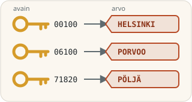

> [!NOTE]
> The English translation for this exercise can be found in [this file](./readme.en.md).

# Map-harjoitukset



Tämän harjoitustehtäväpaketin myötä opit hyödyntämään Map-tietorakennetta omissa sovelluksissasi. Harjoitusten tueksi suosittelemme lukemaan Oraclen [dev.java](https://dev.java/)-tutoriaalista sivut [Using Maps to Store Key Value Pairs](https://dev.java/learn/api/collections-framework/maps/) sekä [Managing the Content of a Map](https://dev.java/learn/api/collections-framework/working-with-keys-and-values/).

> *"A hashmap is a structure able to store key-value pairs. The value is any object your application needs to handle, and a key is something that can represent this object.*
>
> *Suppose you need to create an application that has to handle invoices, represented by instances of an Invoice class. Then your values are these Invoice instances, and your keys could be the invoice numbers. Each invoice has a number, and that number is unique among all your invoices."*
>
> Using Maps to Store Key Value Pairs. Oracle. https://dev.java/learn/api/collections-framework/maps/

## Tehtävän aloittaminen

Forkkaa ensin tämä repositorio omaan GitHub-repositorioosi GitHubin **Fork**-painikkeella ja kloonaa vasta sitten oma forkkisi koneellesi:

```sh
git clone https://github.com/<oma-github-tunnuksesi>/3-map-exercises.git
```

Avaa kloonattu projekti koodieditorissasi.

## Testaaminen

Tehtävän osille on valmiit [JUnit](https://junit.org/)-yksikkötestit hakemistossa [src/test/java](./src/test/java/). Kunkin osan kohdalla kerrotaan, millä testiluokalla se arvioidaan. Voit ajaa testit koodieditorisi testaustyökalulla ([VS Code](https://code.visualstudio.com/docs/java/java-testing), [Eclipse](https://www.vogella.com/tutorials/JUnitEclipse/article.html)) tai [Gradlella](https://docs.gradle.org/current/userguide/java_testing.html), esimerkiksi:

```
./gradlew test --tests MapBasicsTest        # unix
.\gradlew.bat test --tests MapBasicsTest    # windows
```

Lisää komennon loppuun `--info`, jos haluat tarkemmat tiedot epäonnistuneista testeistä. Testien tekniseen toteutukseen ei tarvitse perehtyä, ja voit kokeilla ratkaisuasi myös omalla `main`-metodilla. Saat kirjoittaa omia testejä lisää, mutta älä muuta tai poista valmiita testejä.

Älä muuta valmiiden luokkien, metodien ja konstruktorien nimiä, parametreja tai paluuarvojen tyyppejä, sillä silloin testit eivät käänny. Saat tiedoston alkuperäisen version takaisin komennolla `git restore <tiedoston polku>` tai kurssijärjestelmän **Palauta lähtökoodi** -toiminnolla.

## Palauttaminen ja pisteet

Jokaisella tehtävän osalla on kurssijärjestelmässä (https://jtjuslin.kapsi.fi/java) oma sivunsa, jonka koodikentissä on osan koodipohja. Kopioi ratkaisusi koodikenttiin tai kirjoita se suoraan niihin. **Testaa ilman palautusta** ajaa osan testit tallentamatta pisteitä, ja **Lähetä** palauttaa ratkaisun. Jokainen testiluokka hyväksytään vain, jos sen kaikki testit menevät läpi, ja pisteet jaetaan hyväksyttyjen testiluokkien mukaan.

**Pisteet kahdessa vaiheessa**

1. Kun ratkaisusi menee läpi kurssijärjestelmässä, saat osasta **puolet pisteistä**.
2. Pushaa lopuksi kaikki julkiseen GitHub-repositorioosi. Paina tämän jälkeen osan sivulla **Lähetä tarkistettavaksi** -nappia. Kun testit menevät läpi, saat osasta **täydet pisteet**. Repositorio saa jäädä julkiseksi.

GitHubissa ei ole arvioivaa YAML-tehtävävirtaa (GitHub Actions -workflowta), eikä `git push` käynnistä arviointia. Kun painat **Lähetä tarkistettavaksi**, kurssijärjestelmän botti hakee koodisi repositoriostasi ja tarkistaa sen samoilla testeillä. Molemmat vaiheet pitää tehdä ennen luvun määräaikaa. Voit lähettää ratkaisusi niin monta kertaa kuin tarvitset, ja voimaan jää paras tulos.


## Tehtävä 1: MapBasics *(perusteet, 40 %)*

Tässä tehtävässä harjoittelet uuden `Map`-olion luontia sekä tyypillisimpiä operaatioita tiedon lisäämiseksi, hakemiseksi, muuttamiseksi ja poistamiseksi.

[MapBasics](./src/main/java/part01/MapBasics.java)-luokan metodien javadoc-kommentit kertovat, miten kunkin metodin tulee toimia. **Lue kommentit ja toteuta metodien sisältö vastaamaan metodin nimeä ja kuvausta.**

Arvioinnissa ajetaan testiluokka [MapBasicsTest](./src/test/java/part01/MapBasicsTest.java).

🚀 *Monet tämän luokan metodeista eivät riipu mapin avainten ja arvojen tyypeistä. Esimerkiksi `countEntries` toimisi yhtä hyvin `<String, String>`- kuin `<String, Integer>`-tyyppisen mapin kanssa. Oikeassa ohjelmassa käyttäisit todennäköisesti geneerisiä tyyppejä, kuten `Map<K, V>`. Geneerisiin tyyppeihin ei tarvitse vielä perehtyä, mutta voit halutessasi toteuttaa metodit geneerisinä: https://dev.java/learn/generics/.*


## Tehtävä 2: MapExperts *(soveltaminen, 30 %)*

Tässä tehtävässä jatketaan `Map`-operaatioita soveltavien tehtävien muodossa. Ne ovat haastavampia ja edellyttävät laajempaa ongelmanratkaisua kuin yksittäisen metodin käyttöä.

Toteuta [MapExperts](./src/main/java/part02/MapExperts.java)-luokan metodit niiden javadoc-kommenttien mukaisesti: kirjainten esiintymien laskeminen, mapin kääntäminen ja [Course](./src/main/java/part02/Course.java)-olioiden listan muuttaminen mapiksi. `Course` on valmis record-luokka.

Arvioinnissa ajetaan testiluokka [MapExpertsTest](./src/test/java/part02/MapExpertsTest.java).


## Tehtävä 3: PostalCodesMain *(soveltaminen, 15 % + 15 %)*

[JSON (JavaScript Object Notation)](https://www.json.org/) on kevyt ja yleinen tapa tallentaa ja siirtää rakenteellista tietoa ohjelmien välillä. JSON-muotoinen data voi näyttää esimerkiksi seuraavalta:

```json
{
    "74701": "KIURUVESI",
    "35540": "JUUPAJOKI",
    "74705": "PAKETTIAUTOMAATTI",
    "74704": "SMARTPOST",
    "44884": "SMART POST"
}
```

Map-tietorakenne soveltuu erinomaisesti tällaisten avain-arvo-parien käsittelyyn. Tässä tehtävässä käsitellään postinumeroaineistoa, joka on tallennettu JSON-tiedostoon [postcode_map_light.json](./data/postcode_map_light.json). Tiedoston lukeminen on toteutettu valmiiksi [PostalCodesReader](./src/main/java/part03/PostalCodesReader.java)-luokassa, joka käyttää Googlen [GSON-kirjastoa](https://github.com/google/gson). GSONiin ei tarvitse perehtyä.

🚀 *GSON ei ole osa Javan standardikirjastoa, vaan se on lisätty projektiin Gradlen avulla. Löydätkö [build.gradle](./build.gradle)-tiedostosta, miten ja mihin GSON on määritetty?*

### Käyttöliittymä

Saat toteuttaa ratkaisun parhaaksi katsomallasi tavalla ja luoda tarvitsemasi luokat ja metodit. Ohjelman on kuitenkin käynnistyttävä [PostalCodesMain](./src/main/java/part03/PostalCodesMain.java)-luokan `main`-metodista, kysyttävä käyttäjältä vain yksi syöte, tulostettava vastaus alla esitetyssä muodossa ja lopetettava. Hae postinumerot `PostalCodesReader`-luokan `readPostalCodes`-metodilla.

**Postinumero (15 %)**

Jos käyttäjä syöttää postinumeron, ohjelma tulostaa sitä vastaavan postitoimipaikan:

```
Input postal code or district (e.g., 00100 or Helsinki): 00100

Post office: HELSINKI
```

Jos postinumeroa ei löydy, tulosta esimerkiksi "Post office not found."

**Toimipaikan nimi (15 %)**

Jos käyttäjä syöttää toimipaikan nimen, ohjelma tulostaa kaikki sen postinumerot:

```
Input postal code or district (e.g., 00100 or Helsinki): Porvoo

Postal codes: 06100, 06101, 06150, 06151, 06200, 06400, 06401, 06450, 06500
```

Nimen kirjainkoolla ei ole väliä, eikä osittaisia osumia näytetä. Postinumeroiden tulee olla **kasvavassa järjestyksessä pilkulla ja välilyönnillä eroteltuina**, joten kerää ne ensin esimerkiksi listalle ja [järjestä](https://docs.oracle.com/en/java/javase/17/docs/api/java.base/java/util/Collections.html#sort(java.util.List)) se ennen tulostamista. Jos nimelle ei löydy postinumeroita, tulosta esimerkiksi "Postal codes not found."

### Ohjelman suorittaminen ja arviointi

Voit suorittaa ohjelman koodieditorisi Run-painikkeella tai Gradlella:

```
./gradlew --quiet --console plain run         # unix
.\gradlew.bat --quiet --console plain run     # windows
```

Ensimmäinen suorituskerta voi olla hidas, mutta [Gradlen välimuisti nopeuttaa seuraavia](https://docs.gradle.org/current/userguide/build_cache.html). Gradle tietää käynnistää `PostalCodesMain`-luokan, koska se on määritetty pääohjelmaksi [build.gradle](./build.gradle)-tiedostossa.

Kurssijärjestelmä ajaa ohjelmasi eri syötteillä kahdella testiluokalla. Ne eivät ole tässä repositoriossa, joten kokeile ohjelmaa itse yllä olevilla esimerkeillä. Valmis [PostalCodesReaderTest](./src/test/java/part03/PostalCodesReaderTest.java) testaa vain annettua tiedostonlukijaa.

* `PostalCodeLookupTest` *(postinumero, 15 %)*: syötteillä esimerkiksi `19230`, `00100`, `99999` ja `71820` tulosteessa pitää olla vastaava toimipaikka (ONKINIEMI, HELSINKI, KORVATUNTURI ja PÖLJÄ). Osittainen postinumero, kuten `001`, ei saa tuottaa tulosta.
* `PostalDistrictLookupTest` *(toimipaikan nimi, 15 %)*: syötteillä esimerkiksi `tammisaari`, `TAMMISAARI`, `Porvoo` ja `kauniainen` tulosteessa pitää olla toimipaikan postinumerot kasvavassa järjestyksessä. Osittainen nimi, kuten `Porv`, ei saa tuottaa tulosta.

💡 *Testi poimii tulosteesta kaikki viisinumeroiset luvut, joten älä tulosta muita viisinumeroisia lukuja kuin löydetyt postinumerot. Syötekysymyksen esimerkki "(e.g., 00100 or Helsinki)" jätetään huomiotta.*


## Bonustehtävä 4: MorseCode *(soveltaminen, 0 %)*

Tämä vapaaehtoinen bonustehtävä ei vaikuta pisteisiin. Toteuta [MorseCode](./src/main/java/part04/MorseCode.java)-luokan metodit `textToMorse` ja `morseToText`, jotka muuntavat tekstiä morsekoodiksi ja päinvastoin:

```
hello world
.... . .-.. .-.. ---   .-- --- .-. .-.. -..
```

Lisätietoja morsekoodista löytyy esimerkiksi Wikipediasta: https://en.wikipedia.org/wiki/Morse_code. [MorseApp](./src/main/java/part04/MorseApp.java)-luokkaa ei tarkisteta.

Tehtävää kokeillaan testiluokalla [MorseCodeTest](./src/test/java/part04/MorseCodeTest.java).


## Lisenssi ja tekijät

Tämän tehtävän ovat kehittäneet Teemu Havulinna ja Jukka Juslin, ja se on lisensoitu [Creative Commons BY-NC-SA -lisenssillä](https://creativecommons.org/licenses/by-nc-sa/4.0/). Tehtävänannon, lähdekoodien ja testien toteutuksessa on hyödynnetty ChatGPT 3.5 -kielimallia sekä GitHub Copilot -tekoälyavustinta.

**Postinumeroaineisto.** Aineisto [postcode_map_light.json](./data/postcode_map_light.json) on lainattu projektin https://github.com/theikkila/postinumerot tiedostosta [postcode_map_light.json](https://github.com/theikkila/postinumerot/blob/master/postcode_map_light.json) 7.6.2023. Datan tekijänoikeudet kuuluvat Postille, ja sitä käytetään [Postin käyttöehtojen](https://www.posti.fi/fi/asiakastuki/postinumerotiedostot) mukaisesti. Jos teet kopioita aineistosta, huolehdi käyttöehtojen noudattamisesta.

**Ohjelmoinnin MOOC.** `MapExperts`-luokan metodeissa on otettu vahvasti vaikutteita Helsingin yliopiston Ohjelmoinnin perusteet -MOOC-kurssin Python-kielisistä tehtävistä osoitteessa https://ohjelmointi-23.mooc.fi/osa-5. Ohjelmoinnin MOOC on lisensoitu CC BY-NC-SA 4.0 -lisenssillä:

> *Kurssimateriaalin ja tehtävien tekijät ovat Erkki Kaila, Antti Laaksonen ja Matti Luukkainen. Muutama kurssin tehtävistä on Arto Hellaksen (né Vihavainen) käsialaa.*
>
> *Kurssin materiaali on lisensoitu [Creative Commons BY-NC-SA 4.0](https://creativecommons.org/licenses/by-nc-sa/4.0/deed.fi) -lisenssillä, joten voit käyttää ja levittää sitä vapaasti, kunhan alkuperäisten tekijöiden nimiä ei poisteta. Jos teet muutoksia materiaaliin ja haluat levittää muunneltua versiota, se täytyy lisensoida samalla lisenssillä. Materiaalien käyttö kaupalliseen tarkoitukseen on ilman erillistä lupaa kielletty.*
